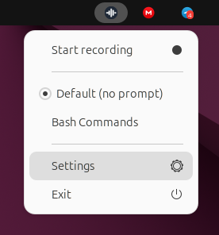
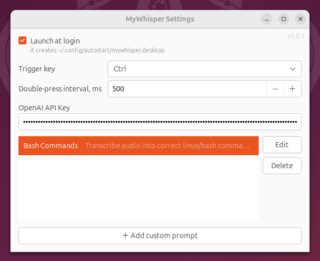

 


# mywhisper-gtk

Minimalist Whisper for voice input in different Linux applications, including terminal apps.

Transcription is powered by the `gpt-transcribe` model. When a custom prompt is selected,
the completed transcript is processed by `gpt-5-nano` in a separate request using the same API key.
Only the processed text is inserted. Without a prompt, the transcript is used directly.
If processing fails, no text is inserted; the error is logged.

Tested on Ubuntu 24.04 with an X11 server.

## Quick start

Download the latest AppImage from [Releases](https://github.com/phplego/mywhisper/releases/latest).

Make the AppImage executable and run it:

```bash
chmod +x mywhisper-gtk-*.AppImage
./mywhisper-gtk-*.AppImage
```

Set `OpenAI API Key` in app settings (`Settings` in tray menu).

## Build from source

Install the dependencies, build, and run:

```bash
sudo apt update
sudo apt install -y build-essential libayatana-appindicator3-dev libxtst-dev libsoup-3.0-dev libjson-glib-dev alsa-utils opus-tools
make build
./app.out
```

## Screenshots






## Hotkeys

| Hotkey | Action |
|---|---|
| Double `Ctrl` / `Shift` / `Alt` | Start/stop voice input; key and interval are configurable in settings |
| `Esc` (during voice input) | Cancel |
